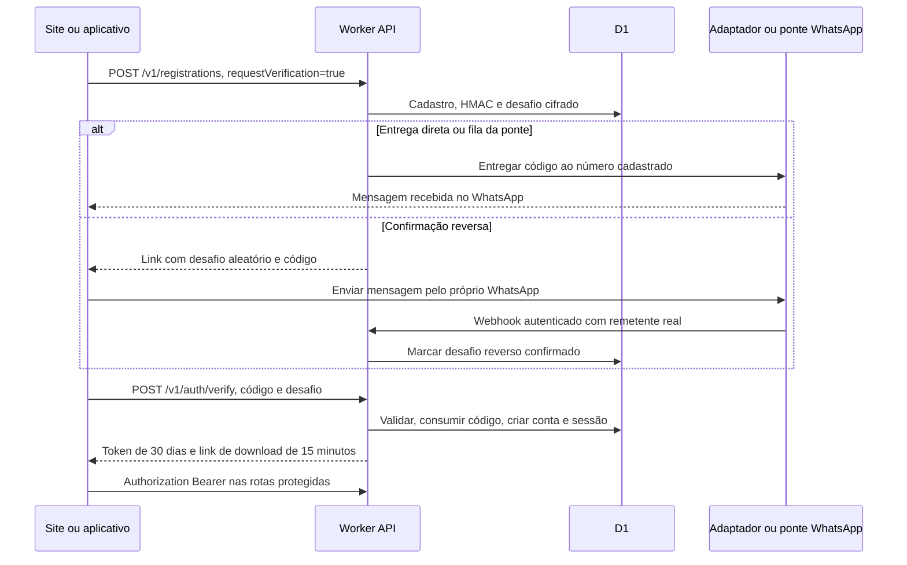

# Autenticação do ZapDMR 1.3.1

Revisão de código em **20/10/2026**, cobrindo o portal, o app Windows/Android, o Worker + D1, a alternativa Node e a ponte WhatsApp local. O documento descreve a implementação. O pareamento pelo responsável e a primeira entrega real de OTP ainda estão pendentes nesta revisão.

## Componentes

| Componente | Responsabilidade | Fonte |
| --- | --- | --- |
| Portal | Cadastro, confirmação de seis dígitos e download após validação | [site.js](public/site.js) |
| App Windows/Android | Cadastro do perfil, desafio OTP, token Bearer e ZapChat | [community.js](../web/community.js) |
| Worker HTTP | Rotas, origens, CSP, HTTPS e assets | [worker.mjs](cloudflare/worker.mjs) |
| API | Desafios, fila WhatsApp, validação, sessões e autorização | [api.mjs](cloudflare/api.mjs), funções issueChallenge, challengeView, currentUser e handleDownload |
| D1 | Cadastros, contas, desafios, hashes de sessão, fila cifrada, mensagens e bloqueios | [schema.sql](cloudflare/schema.sql) |
| Ponte Windows | Pareamento QR, envio da fila e recepção da confirmação reversa | [bridge.mjs](whatsapp-bridge/bridge.mjs), [instruções](whatsapp-bridge/README.md) |
| Backend Node alternativo | Mesma confirmação direta/reversa; homologação local isolada | [server.mjs](server.mjs) |
| Proteção no aparelho | Persistir telefone e token em armazenamento nativo cifrado | [secret-store.ts](../src/server/secret-store.ts), [MobileAudioPlugin.java](../android/app/src/main/java/br/radio/zapdmr/MobileAudioPlugin.java) |

As credenciais da comunidade, rádio HBP, administração e publicação têm usos distintos. GitHub e Cloudflare autenticam o mantenedor para publicar; essas contas não autenticam os operadores do ZapDMR.

## Cadastro e confirmação



1. **Cadastro:** POST /v1/registrations valida indicativo, DMR ID de sete dígitos, número E.164 e aceite explícito. Guarda telefone cifrado e HMAC de busca. Com requestVerification=true, emite o desafio e abre a etapa de confirmação. O retorno permanece verified=false e downloadUrl=null. A opção de compartilhar telefone é independente do aceite.
2. **Desafio:** seis dígitos criptograficamente aleatórios, validade de dez minutos, reenvio após 60 segundos e até cinco tentativas. O código está vinculado ao cadastro e à identidade imutável. O servidor impede vincular um indicativo/DMR ID já existente a outra identidade ou telefone.
3. **Entrega e prova do número:** a API escolhe o modo disponível descrito abaixo. Não há código mestre nem confirmação por mero clique em um link.
4. **Verificação:** POST /v1/auth/verify confere código, prazo, tentativas, identidade e, no modo reverso, a mensagem recebida. Um lote condicionado do D1 cria/atualiza a conta, cria a sessão e consome o código para impedir reutilização. Números reais confirmados recebem whatsapp_verified=1 e verified_at.
5. **Sessão:** token opaco de 32 bytes aleatórios, Base64URL com 43 caracteres, válido por 30 dias. Não é JWT. O banco guarda seu HMAC, usuário e expiração. currentUser consulta a sessão em cada chamada protegida. Não há cookie de sessão nem refresh token.
6. **Download:** somente após validação a API devolve o link HMAC de 15 minutos. O token contém ID do cadastro, plataforma e expiração; handleDownload também exige whatsapp_verified=1 e verified_at. O redirecionamento só usa uma URL HTTPS de Release permitida.

As Releases públicas do GitHub continuam acessíveis fora do fluxo do portal. O código-fonte GPL em /source é público. A sessão do ZapChat não é o token temporário do instalador.

## Três formas de entrega real

### Adaptador HTTPS

WHATSAPP_API_URL e WHATSAPP_API_TOKEN configuram POST privado com Authorization Bearer e:

```json
{"number":"+5543999999999","text":"*ZapDMR:* Olá PU5RZS, seu código de confirmação de 6 dígitos é: *482910*. Forte 73!"}
```

O adaptador precisa aceitar esse contrato e entregar a mensagem pelo provedor. Um provedor com payload ou template diferente requer adaptação. O contrato anterior OTP_DELIVERY_URL/OTP_DELIVERY_TOKEN recebe {phone,code,expiresInSeconds:600}. Tokens ficam apenas no servidor; não são enviados ao site ou app.

### Fila e ponte local QR

Com WHATSAPP_LOCAL_BRIDGE=1, número oficial configurado e heartbeat recente de uma sessão conectada, o Worker usa mode=bridge. Ele cifra o destino/texto da fila e oferece trabalhos à ponte autenticada. Cada consulta recebe leaseId; os ACKs de envio/falha precisam corresponder à mesma tentativa. Um ACK antigo não encerra a tentativa seguinte. A ponte mantém IDs enviados limitados e cifrados para reduzir duplicação; uma interrupção no momento exato do envio ainda impede garantia de exatamente uma entrega.

A ponte usa Baileys 6.7.24, um cliente independente e sem vínculo oficial com a Meta. Seu painel é local, http://127.0.0.1:4193, e o número esperado é **+5543996741200**. No primeiro vínculo, a conexão começa após ação no painel; uma sessão protegida já vinculada ao número correto pode ser retomada ao reiniciar. O responsável precisa escanear o QR em WhatsApp → Aparelhos conectados → Conectar aparelho. A identidade conectada precisa corresponder ao número oficial; o comparador admite somente o alias específico do nono dígito móvel brasileiro.

A ponte consulta a fila por HTTPS de saída a cada cinco segundos, com WHATSAPP_WEBHOOK_TOKEN em Bearer. Não existe túnel ou endpoint público no computador. O PC precisa permanecer ligado e online. A interface distingue pedido na fila de envio confirmado. Sem conexão da ponte, o fluxo oferece a confirmação reversa configurada.

### Confirmação reversa

A API gera um token aleatório de desafio com 43 caracteres e a mensagem pronta:

```text
ZapDMR CONFIRMAR <desafio> <codigo-de-6-digitos>
```

O link wa.me contém o número oficial e esse texto. O titular envia a mensagem pelo WhatsApp que cadastrou. A ponte extrai o remetente da identidade PN autenticada pelo WhatsApp; não interpreta os dígitos de um LID como número. Mensagens próprias, grupos, broadcasts, histórico e textos fora do formato não são encaminhados.

POST /v1/whatsapp/webhook exige o segredo Bearer da ponte e confere remetente, token, código, expiração e tentativas. Só então registra reverse_confirmed_at. O site/app consulta POST /v1/auth/status e conclui verify após confirmação. Conhecer o código visível, mudar o texto ou abrir wa.me não substitui a prova do remetente.

A mensagem recebida pelo WhatsApp demonstra acesso ao número naquele momento; não demonstra licença de radioamador, propriedade do indicativo ou atribuição do DMR ID.

## Dados e credenciais

| Valor | Onde fica e para que serve |
| --- | --- |
| DATA_ENCRYPTION_KEY | Secret do Worker. AES-256-GCM e HMAC de dados, código, sessão e limites. Não chega ao app. |
| DOWNLOAD_SECRET | Secret distinto que assina links temporários de instalador. |
| ADMIN_PASSWORD | Secret exclusivo de /admin, autenticação Basic sobre HTTPS. |
| WHATSAPP_API_TOKEN / OTP_DELIVERY_TOKEN | Bearer exclusivo do adaptador de entrega configurado. |
| WHATSAPP_WEBHOOK_TOKEN | Secret do Worker e configuração DPAPI privada da ponte; autentica webhook, fila, heartbeat e ACK. |
| Telefone e conteúdo de ZapChat | Cifrados com AES-GCM antes de persistir no banco, IV aleatório de 12 bytes e tag de 128 bits. |
| Desafio OTP no Worker | HMAC para comparação; token/código também ficam cifrados em challenge_cipher para reconstruir confirmação reversa. Payload da fila é cifrado. Nunca são guardados em texto claro no banco. |
| Token de operador | HMAC no D1; valor original entregue ao cliente na validação e protegido no armazenamento nativo. |

Indicativo, DMR ID, participantes e horários permanecem como metadados consultáveis. O servidor possui a chave para decifrar mensagens de ZapChat: a cifragem não é ponta a ponta.

**Windows do operador:** localSave chama /api/community-profile, que grava community-profile.dpapi. O helper do app tenta CurrentUser e pode usar LocalMachine como fallback; a proteção do computador e permissões do arquivo continuam relevantes. A API local aceita loopback.

**Android:** saveRadioConfig usa AES-GCM e preferências privadas, com chave no AndroidKeyStore. O JavaScript recebe o perfil decifrado quando necessário ao uso.

**Windows da ponte:** config.dpapi e session.dpapi usam exclusivamente DPAPI CurrentUser, sem fallback de máquina. Credenciais Baileys, chaves Signal e IDs de entrega são serializados com BufferJSON, cifrados e gravados de forma serializada/atômica. Não se usa armazenamento de autenticação em JSON aberto. A ponte não arquiva conversas pessoais ou contatos.

O painel da ponte valida Host, origem local e token de controle, não libera CORS e não escuta interfaces públicas. QR e material privado não são impressos em logs. Um dispositivo comprometido ainda pode acessar segredos em uso na memória.

## Autorização e encerramento

- Perfil, diretório, bloqueios e mensagens exigem sessão Bearer válida.
- O diretório aceita pesquisa exata. O número só é entregue ao titular ou quando a partilha está autorizada; bloqueios valem nas duas direções.
- O remetente de ZapChat vem da sessão. As consultas limitam as mensagens ao par autorizado.
- Receber 401 limpa a sessão local. Alterar servidor, identidade ou telefone também limpa o vínculo local.
- Sair da comunidade apaga o token local; não revoga automaticamente cópias anteriores ou outras sessões. Elas expiram após 30 dias.
- DELETE /v1/me elimina conta e dependências, incluindo sessões e conversas. A limpeza agendada remove dados expirados e cadastros pendentes antigos.
- /admin usa usuário admin e senha secreta com limite de tentativas. Basic é codificação, portanto HTTPS é necessário.

## Homologação local

OTP_MODE=development só funciona no backend Node não produtivo, com origem, escuta e cliente locais. Usa zapdmr-development.sqlite separado. O código é mostrado como demonstração, e a conta recebe whatsapp_verified=false e verification_method=development. O Worker recusa esse modo. Contas de homologação não confirmam números de produção.

## Rádio e publicação

O rádio HBP/BrandMeister usa Radio ID + ESSID e Hotspot Security Password. O gateway envia RPTL, responde ao desafio com SHA-256(salt + password) em RPTK e envia RPTC. Não usa telefone, OTP ou token da comunidade. Fontes: [gateway Windows](../src/server/brandmeister-gateway.ts) e [serviço Android](../android/app/src/main/java/br/radio/zapdmr/RadioSessionService.java).

Wrangler e GitHub usam autorizações do mantenedor para publicar. configure-secrets.mjs reutiliza o backup protegido e passa segredos por stdin. Arquivos .env, .dev.vars, .wrangler, bancos, credenciais de assinatura, sessões DPAPI e backups privados não entram no GitHub ou nos assets.

## Estado observado e limites

Em 20/10/2026, o frontend/backend 1.3.1 estão publicados; o D1 recebeu a migração e os builds 1.3.1 existem localmente. A ponte está aberta com QR e aguarda o responsável. Não foi comprovada entrega real, validação positiva de OTP em produção ou conversa entre dois aparelhos.

Não há recuperação automática de titularidade, revogação individual de sessão, autenticação multifator ou verificação de licença neste fluxo. CORS e CSP complementam a autorização, sem substituir o Bearer. Polling de mensagens pode demorar até 25 segundos; o módulo cliente ainda usa o contrato básico e não consome o canal separado de recibos ao vivo.

Consulte [WHATSAPP-OTP.md](WHATSAPP-OTP.md), [implantação](cloudflare/README.md) e [verificação de 20/10/2026](VERIFICACAO-2026-10-20.md).
